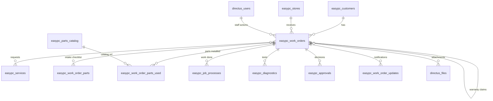

# EasyPC — Directus Data Model

Data model for the EasyPC work order system, derived from `EasyPC_Service_Form.docx` and the proposed six-stage service journey. **All created artifacts are prefixed `easypc_`** — collections, junctions, flows, roles — keeping the schema cleanly separated from `directus_*` system tables.

## Service journey (reference)

| Stage | Name | What happens |
|-------|------|--------------|
| 01 | Choose intake path | Wait for assessment or leave device |
| 02 | Register device | Record device, symptoms, condition & accessories |
| 03 | Assess now or later | Technician assesses when capacity is available |
| 04 | Decide | Customer approval when required by policy |
| 05 | Repair & test | Work proceeds within authorization |
| 06 | Release | Notify customer and return device |

> The **Work Order Number confirms receipt — not diagnosis or repair acceptance.** Email updates notify customers when meaningful work-order milestones or technician updates are recorded.

## Collections at a glance

| Collection | Kind | Source on form | Purpose |
|------------|------|----------------|---------|
| `easypc_customers` | entity | Customer name / contact / email | Reusable customer records; one customer → many work orders |
| `easypc_stores` | lookup | Store | Branch that received the unit |
| `easypc_services` | lookup | §1 Service checkboxes | Diagnosis, Recase, Upgrade, Cleaning, PC Assembly |
| `easypc_parts_catalog` | lookup | Replacement parts sold | Current catalog price; not inventory (Odoo's job later) |
| `easypc_work_orders` | entity (core) | Header + §1 + §4 + §5 + signatures | One record from intake through release; carries status |
| `easypc_work_order_parts` | child (O2M) | §2 Parts checklist rows | One row per part type checked at intake |
| `easypc_work_order_parts_used` | child (O2M) | Parts/items installed & charged | Transactional lines — catalog pick or manual entry, price snapshot, approval link, warranty |
| `easypc_job_processes` | child (O2M) | §3 Process rows | Cleaning / Install-Upgrade / Troubleshooting coverage done |
| `easypc_diagnostics` | child (O2M) | §3 Full diagnostic rows | One row per tested area, with metrics |
| `easypc_approvals` | child (O2M) | §4 Customer informed/approved | Approval rounds (initial + additional work per T&C clause 1) |
| `easypc_work_order_updates` | child (O2M) | Email-update promise | Technician notes / milestones that trigger customer email |
| `easypc_work_orders_files` | junction (M2M) | §2 photos, signatures | Photos & attachments on a work order, with category |
| `easypc_work_orders_services` | junction (M2M) | §1 services ticked | Links work orders ↔ services; snapshots `charged_price` per order |

Staff references (`received_by`, `assessed_by`, `done_by`, `tested_by`, `released_by`, `recorded_by`) point to `directus_users` — no separate staff collection needed.

## Entity relationships

## Design decisions

1. **One work order record for the whole journey.** Stages 01–06 are expressed through the `status` field plus child collections — matching the "one service record" principle.
2. **Checklist sections become child collections**, not JSON blobs on the work order, so parts, tests, and processes are queryable and reportable. The fixed option lists (part types, coverage items, diagnostic tests) stay as `select`/`json` values since the form defines them.
3. **Approval is its own collection** (`easypc_approvals`), not a field. T&C clause 1 requires written OK for extra work — multiple approval rounds per work order must be possible.
4. **`easypc_work_order_updates` is customer-facing**, distinct from `directus_activity` (internal audit). It exists to drive the promised email notifications via Flows.
5. **Prices are snapshot at transaction time.** `easypc_services` / `easypc_parts_catalog` hold *current* prices; `easypc_work_orders_services.charged_price` and `easypc_work_order_parts_used.unit_price` freeze what was charged on that work order — catalog price changes never rewrite history.
6. **Warranty is tracked per installed part** (`warranty_until` stamped at release) plus a labor warranty on the work order (`service_warranty_until`). A warranty claim is a *new* work order linked via `warranty_claim_of` — it reuses the same journey instead of a separate claims subsystem.
7. **Passwords are never stored.** `password_handling` records only the arrangement (`not_needed` / `customer_to_enter`).
8. **`job_order_no`** stores the handwritten paper form number; **`work_order_number`** is the system-generated public reference quoted in emails and used for claims.
9. **Customer is a separate collection** for dedup/history; create-or-match by contact number or email at intake.
10. **Multi-branch ready.** `store` on every work order + `easypc_store` on `directus_users`; non-manager roles are permission-filtered to their branch, `easypc_manager` sees all. `store.code` can prefix WO numbers for per-branch sequences.

## Files in this folder

- `data-model.md` — full field-by-field spec for every collection
- `workflow.md` — status lifecycle ↔ journey mapping, notifications, roles, implementation notes
